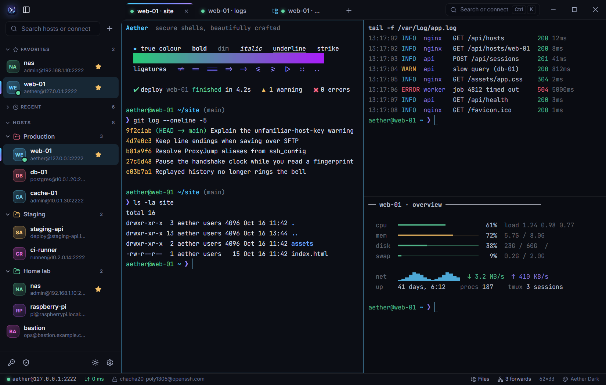
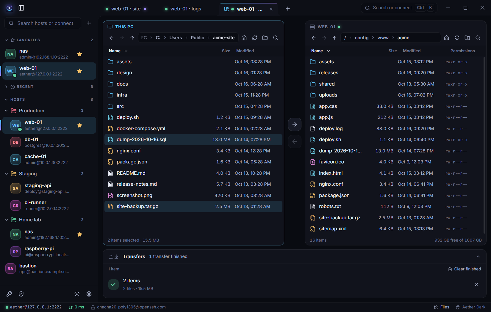
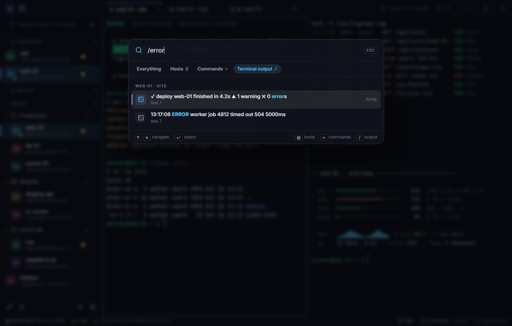
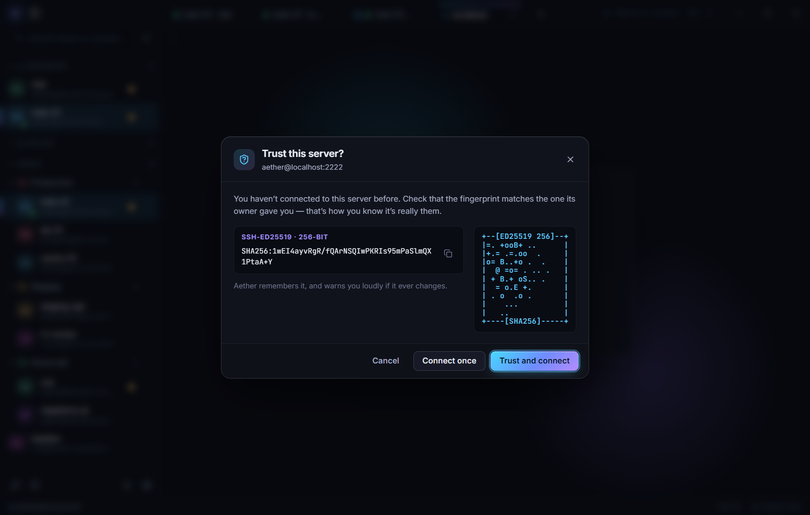
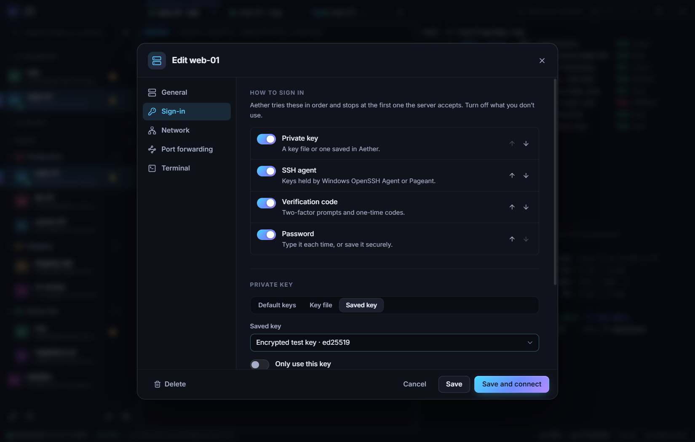
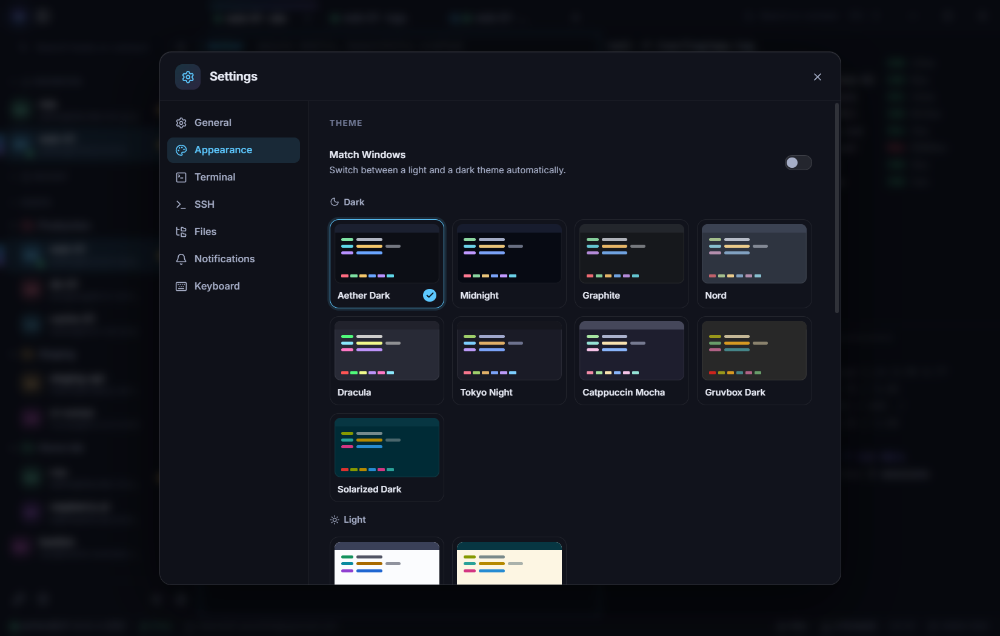
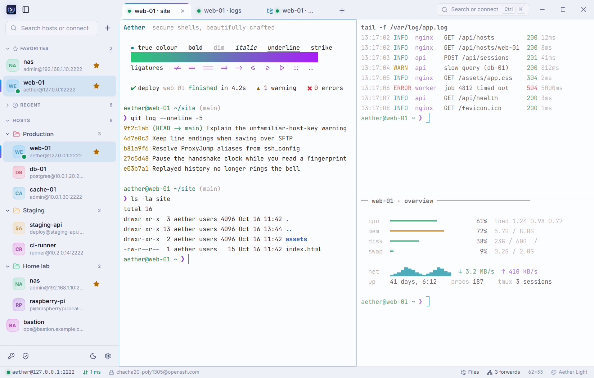
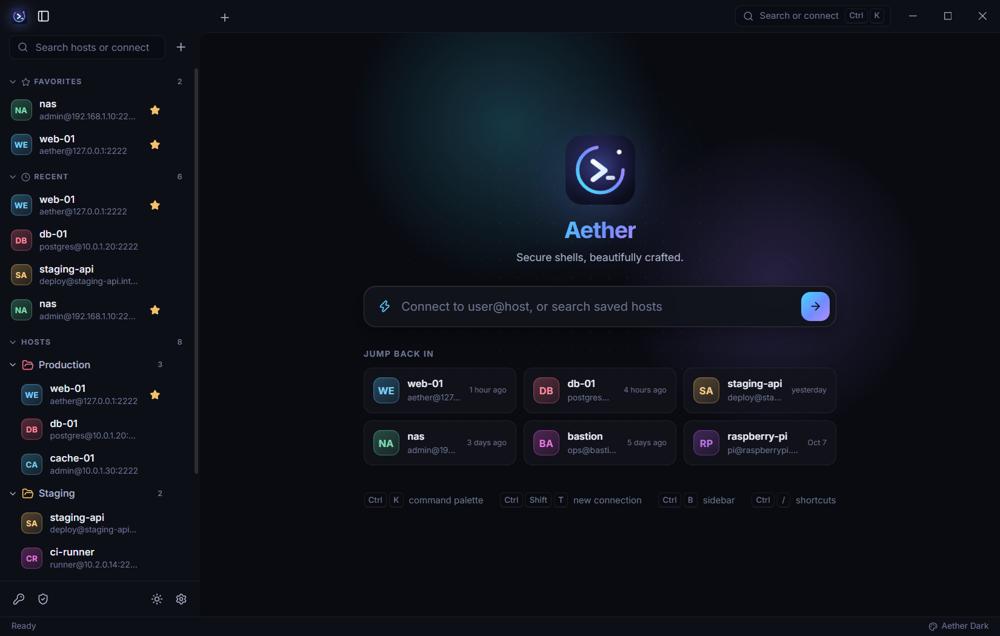

<p align="center">
  
</p>

<h1 align="center">Aether</h1>

<p align="center">
  <strong>Secure shells, beautifully crafted.</strong><br />
  A fast, modern SSH client for Windows — written in Rust, with a terminal that feels native.
</p>

<p align="center">
  
</p>

---

## Why Aether

Most Windows SSH clients are either powerful and dated, or pretty and thin. Aether aims to be both:
a proper SSH engine (jump hosts, agent, forwarding, SFTP, reconnect) behind an interface that stays
out of your way — dark-first, keyboard-first, and calm.

- **Rust all the way down.** The SSH protocol, SFTP, tunnels, key handling and secret storage run in
  Rust ([`russh`](https://github.com/Eugeny/russh)). The UI is a thin Svelte layer inside a
  [Tauri 2](https://tauri.app) shell — there is no SSH logic in JavaScript.
- **Your secrets stay yours.** Passwords and passphrases are only stored if you ask, and then in
  Windows Credential Manager / DPAPI — never in a config file, never in the logs.
- **Honest about trust.** Unknown servers are shown with their fingerprint and randomart; a changed
  host key — or a key type you haven't verified — is a hard stop with a side-by-side comparison, not a
  click-through. What a server sends back (titles, notifications, clipboard requests, file names) is
  treated as untrusted input.

## Features

| | |
|---|---|
| **Terminal** | GPU-accelerated renderer (WebGL), true colour, programming ligatures, inline images (Sixel / iTerm2), emoji and combined characters, hyperlinks, search with highlights, scrollback, copy-on-select, bracketed paste with a multi-line safety check, per-host font and theme, shell integration (working directory, “command finished” notifications) and the clipboard / notification escape sequences programs use. |
| **Layout** | Tabs, split panes (right / down, drag the dividers), multiple windows, tab tear-off that keeps the session running, restore your tabs on start. |
| **Hosts** | Groups (nested), tags, favourites, colours, notes, fuzzy search, `~/.ssh/config` import (including `ProxyJump`, `IdentityFile`, `LocalForward`), quick connect (`user@host:port` — or paste a whole `ssh -J bastion -i key -p 2222 me@host` command), recents, system-tray quick connect, launch at sign-in. |
| **Sign-in** | Password, public key (files or Aether's encrypted vault, with passphrase prompts), SSH agent (Windows OpenSSH agent or Pageant), keyboard-interactive / 2FA. Method order is yours to set per host. |
| **SFTP** | Dual-pane local ⇄ remote browser, drag and drop to and from Explorer, transfer queue with pause / resume / cancel, conflict resolution (replace, skip, keep both, per-file), rename, delete, new folder, `chmod` with a permission grid, a small built-in text editor that keeps line endings and saves safely (through a temporary file, keeping the file's owner and permissions). |
| **Tunnels** | Local (`-L`), remote (`-R`) and dynamic SOCKS5 (`-D`) forwards, saved per host, started automatically and restored after a reconnect, with live traffic counters and clear errors when a server refuses them. |
| **Reach** | `ProxyJump` chains with per-hop prompts, `ProxyCommand`, agent forwarding, X11 forwarding (bring your own X server). |
| **Resilience** | Keepalives that notice a dead network, automatic reconnect with back-off, a replay buffer so a reattached window picks up where it left off, flow control so `cat huge.log` never freezes the UI. |
| **Polish** | Command palette (`Ctrl+K`) with global search, 11 built-in themes plus your own, light / dark / follow-Windows, UI scale and density, reduced-motion friendly, screen-reader mode, notifications for dropped connections and finished commands, onboarding, empty states, custom CSS. |

## A look around

<table>
  <tr>
    <td width="50%">
      <br />
      <sub><b>Files.</b> A dual-pane browser with a transfer queue: drag between the panes or press the arrows, pause, resume or cancel. The built-in editor keeps line endings and ownership.</sub>
    </td>
    <td width="50%">
      <br />
      <sub><b>Everything from the keyboard.</b> <kbd>Ctrl</kbd>+<kbd>K</kbd> reaches hosts, tabs and commands — and <kbd>/</kbd> searches the output of every open terminal, jumping straight to the line.</sub>
    </td>
  </tr>
  <tr>
    <td width="50%">
      <br />
      <sub><b>Trust, spelled out.</b> A new server shows its fingerprint and randomart. A changed key is a hard stop with a side-by-side comparison, not a click-through.</sub>
    </td>
    <td width="50%">
      <br />
      <sub><b>Sign-in your way.</b> Keys, SSH agent, 2FA codes and passwords, tried in the order you choose — per host, with jump hosts, forwards and terminal settings alongside.</sub>
    </td>
  </tr>
  <tr>
    <td width="50%">
      <br />
      <sub><b>Yours to tune.</b> Eleven themes, accent colours, interface scale and density, fonts and cursors — and custom JSON themes or CSS when you want more.</sub>
    </td>
    <td width="50%">
      <br />
      <sub><b>Light, when you want it.</b> A light theme (or follow Windows), with terminal colours kept readable on a bright background.</sub>
    </td>
  </tr>
  <tr>
    <td colspan="2" align="center">
      <br />
      <sub><b>A calm start.</b> Type <code>user@host</code> to connect, or jump back into what you used last.</sub>
    </td>
  </tr>
</table>

## Install

Download the latest release and pick one:

| Package | Notes |
|---|---|
| `Aether_x.y.z_x64-setup.exe` | Per-user installer — no administrator rights needed. |
| `Aether_x.y.z_x64_en-US.msi` | MSI for managed / enterprise deployment. |
| `Aether-x.y.z-portable-x64.zip` | Unzip anywhere (a USB stick works). Everything Aether stores lives in the `AetherData` folder next to the program. |

The portable build leaves nothing behind on the PC, which has one consequence: Windows only shows desktop
notifications for apps that have a Start-menu entry, so notifications (dropped connections, finished
commands) appear with the installed versions only.

**Requirements:** Windows 10 or 11 (64-bit) and the Microsoft Edge **WebView2 runtime**. Windows 11
and current Windows 10 builds already have it; the installers fetch it if it is missing. For the
portable build, install it from <https://developer.microsoft.com/microsoft-edge/webview2/> if
Aether doesn't start.

## First steps

1. Press **`Ctrl+K`** (or type in the box on the home screen) and enter `user@server` to connect, or
   click **＋** in the sidebar to save a host.
2. Verify the fingerprint the first time. Aether remembers it and warns loudly if it ever changes.
3. Split with **`Ctrl+Shift+D`**, browse files with **`Ctrl+Shift+S`**, open the palette with
   **`Ctrl+K`**. Everything is also reachable with the mouse.

Already use OpenSSH? Choose **Import from ~/.ssh/config…** in the sidebar's **＋** menu (or the palette) — your `Host` blocks, jump
hosts, keys and forwards come across, and Aether also *reads* `~/.ssh/known_hosts` so servers you have
verified before are recognised (it never writes to that file).

## Keyboard shortcuts

Every shortcut can be changed in **Settings → Keyboard**. Press **`Ctrl+/`** to see them all.

| Action | Shortcut |
|---|---|
| Command palette / search | `Ctrl+K` · `Ctrl+Shift+P` |
| New connection | `Ctrl+Shift+T` |
| Next / previous tab | `Ctrl+Tab` · `Ctrl+Shift+Tab` |
| Go to tab 1–9 | `Ctrl+Alt+1` … `Ctrl+Alt+9` |
| Split right / down | `Ctrl+Shift+D` · `Ctrl+Shift+E` |
| Move between panes | `Ctrl+Alt+←` `→` `↑` `↓` |
| Close pane / tab | `Ctrl+Shift+W` |
| Find in terminal | `Ctrl+Shift+F` |
| Copy / paste | `Ctrl+Shift+C` · `Ctrl+Shift+V` |
| Clear screen | `Ctrl+Shift+K` |
| Zoom terminal text | `Ctrl+=` · `Ctrl+-` · `Ctrl+0` |
| Reconnect | `Ctrl+Shift+R` |
| Browse files (SFTP) | `Ctrl+Shift+S` |
| Port forwards | `Ctrl+Shift+L` |
| Toggle sidebar | `Ctrl+B` |
| Settings | `Ctrl+,` |
| New window | `Ctrl+Shift+N` |
| Full screen | `F11` |

> Inside a terminal, plain `Ctrl+K` belongs to your shell (it kills to end of line in Bash and
> readline). Use `Ctrl+Shift+P` there, or turn on *Settings → Terminal → Ctrl+K opens the command
> palette in the terminal*.

## Where your data lives

| Mode | Settings, hosts, known hosts, themes | Secrets, logs, cache |
|---|---|---|
| **Installed** | `%APPDATA%\Aether` | `%LOCALAPPDATA%\Aether` |
| **Portable** (`portable.flag` next to `aether.exe`) | `AetherData\` next to the program | `AetherData\` |
| **Custom** (`AETHER_HOME=<folder>`) | that folder | that folder |

The web view that draws the interface keeps a small profile of its own (caches, nothing about your servers):
installed, that is in `%LOCALAPPDATA%\app.aether.ssh`, as for any Windows app; in the portable and custom modes it
is inside the data folder (`cache\webview`), so removing that folder removes everything.

Hosts, groups and settings are plain JSON (with a `.bak` of the previous version), so they are easy
to back up or put under version control. Secrets are never in those files — see
[docs/SECURITY.md](docs/SECURITY.md). **Settings → General → Open config folder** and **Open logs** jump straight to these locations.

## Customising

- **Themes** — pick one of the built-ins (Aether Dark, Midnight, Aether Light, Graphite, Nord,
  Dracula, Tokyo Night, Catppuccin Mocha, Gruvbox Dark, Solarized Dark / Light) or drop a JSON file into
  the `themes` folder.
- **Custom CSS** — a `custom.css` in the data folder is loaded on top of the app's design tokens.

Both are described in [docs/THEMING.md](docs/THEMING.md).

## Build from source

You need:

- **Rust** (stable, 1.89 or newer — the 2024 edition) with the MSVC toolchain, and the *Desktop
  development with C++* workload of the Visual Studio Build Tools
- **Node.js** 20 or newer
- The WebView2 runtime (see above)

```powershell
git clone <this repository>
cd Aether
npm install

npm run dev        # hot-reloading development build (Vite + cargo)
npm run build      # release build → NSIS installer and MSI under target\release\bundle
```

The portable zip is produced by a small script that wraps the release build:

```powershell
npm run portable   # → dist\Aether-<version>-portable-x64.zip
```

No Node on the machine? `pwsh scripts/setup-toolchain.ps1` downloads a private copy into `.tools\`
(ignored by git) and prints how to put it on `PATH` for the current shell.

### FreeBSD (experimental)

Aether is a Windows application first. The same sources also build for FreeBSD, but that port is young: the
whole workspace is type-checked and linted for `x86_64-unknown-freebsd`, the parts that are specific to Unix are
tested on Linux, and the window, tray and web view have so far only been run on Windows. No packages are built
for it; you build from source.

Install the tools and libraries (the web view is WebKitGTK **4.1**, the GTK 3 / libsoup 3 build of
`www/webkit2-gtk`; `pkg search webkit2-gtk` shows the package names):

```sh
pkg install rust node npm pkgconf gtk3 dbus xdg-utils libayatana-appindicator webkit2-gtk_41
```

The Tauri command line tool has no FreeBSD binary, so `npm run dev` and `npm run build` are not available there;
build the interface and call `cargo` yourself. The `tauri/custom-protocol` feature is what `tauri build` normally
adds: it makes the program carry its own copy of the interface instead of looking for the development server.

```sh
git clone https://github.com/Mythrax-ZS/Aether.git
cd Aether
npm install
npm --workspace ui run build
cargo build --release -p aether --features tauri/custom-protocol
./target/release/aether
```

Cargo fetches `tao` from GitHub at a pinned commit (the 0.37.1 release does not compile on the BSDs; see the note
in the workspace `Cargo.toml`), so `git` must be able to reach github.com during the first build.

What is different there:

- **Saved passwords and passphrases are not kept.** There is no secret store behind Aether on FreeBSD yet, so
  "Remember…" lasts until you quit. *About Aether* in the command palette says *In-memory (not persisted)*.
- **Launch at sign-in** writes `~/.config/autostart/aether.desktop`, which KDE, GNOME, Xfce, MATE, LXQt and the
  like start at login.
- **The tray icon** needs `libayatana-appindicator`. Without it Aether starts anyway, just without a tray.
- Data lives in `~/.config/Aether` (hosts, settings, themes) and `~/.local/share/Aether` (logs, cache), or under
  the `XDG_CONFIG_HOME` / `XDG_DATA_HOME` you have set. `AETHER_HOME=<folder>` works as everywhere.
- Some wording is still Windows-flavoured (the "Recycle Bin" is the freedesktop trash, for one).
- If the window opens blank, or the terminal doesn't draw, start it as
  `WEBKIT_DISABLE_COMPOSITING_MODE=1 ./target/release/aether` — the usual workaround for WebKitGTK and some GPU
  drivers — and, for the terminal, set *Renderer* to *Compatible* under *Settings → Terminal → Advanced*.

### Tests and checks

```powershell
npm test            # cargo test --workspace  +  Vitest   (440+ Rust tests, 100+ UI tests)
npm run lint        # clippy with warnings denied  +  svelte-check (types, accessibility)
npm run fmt         # rustfmt
```

The SSH engine is tested against an in-process SSH server (`aether_ssh::testing`) that can misbehave
on demand — drop connections, forbid forwarding, reject keys, speak X11 — so reconnect logic, host
key policy, forwarding and SFTP are exercised without a network. For manual end-to-end checks any
OpenSSH server works; a throwaway container is the easiest:

```powershell
docker run -d --name aether-test -p 127.0.0.1:2222:2222 `
  -e USER_NAME=aether -e USER_PASSWORD=aether-test -e PASSWORD_ACCESS=true `
  lscr.io/linuxserver/openssh-server
```

### Repository layout

```
crates/
  aether-core/    models, JSON stores, ssh_config parser, known_hosts, errors, paths  (no UI, no network)
  aether-vault/   Credential Manager + DPAPI secret storage behind one trait
  aether-ssh/     the SSH engine: connect, auth, sessions, SFTP, tunnels, X11  (russh)
src-tauri/        the Tauri shell: windows, tray, IPC commands, prompts
ui/               Svelte 5 + TypeScript front end (xterm.js terminal)
docs/             architecture, security, theming
assets/           logo
scripts/          packaging and tooling
```

The architecture, data flow and the reasons behind the main decisions are in
[docs/ARCHITECTURE.md](docs/ARCHITECTURE.md).

## Troubleshooting

- **A connection fails and the message isn't enough.** Open *Technical details* on the error card, or
  **Settings → General → Open logs** — `aether.<date>.log` records every step of the handshake
  (never passwords or key material).
- **"Host key changed — connection blocked".** The server presented a different key than the one you
  trusted. If you know why (a reinstall, a key rotation), remove the old entry under *Known hosts* and
  connect again; if you don't, stop and ask the server's owner.
- **"Unfamiliar host key".** You trusted this server's key of one type (say ed25519) and it now
  identified itself with another (say ECDSA). That is often harmless — a server with several host keys, or
  one that was reconfigured — but it is also what someone in the middle would do, so Aether asks. Compare
  the fingerprint with the server's owner before trusting it; the old key stays on record.
- **X11 programs don't open.** Aether forwards the connection; an X server must be running on your PC
  (VcXsrv, X410, Xming) and accept TCP connections. Set its address under *Settings → SSH*.
- **Aether doesn't start (portable build).** Install the WebView2 runtime.

## Status

Aether is young. The core — terminal, hosts, SFTP, tunnels, jump hosts, reconnect — is built and
covered by tests; expect rough edges at the margins. Not implemented yet: telnet / serial, Mosh,
snippets.

## License

[MIT](LICENSE) © Aether contributors. Third-party components keep their own licences.
