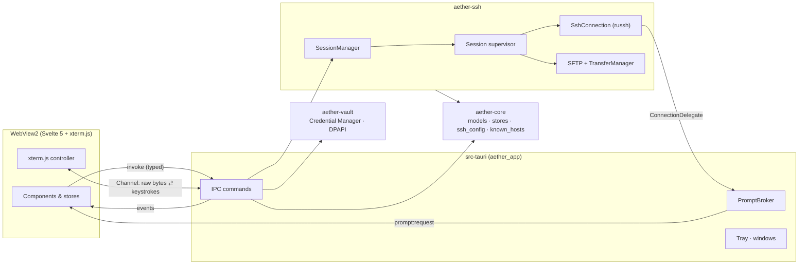
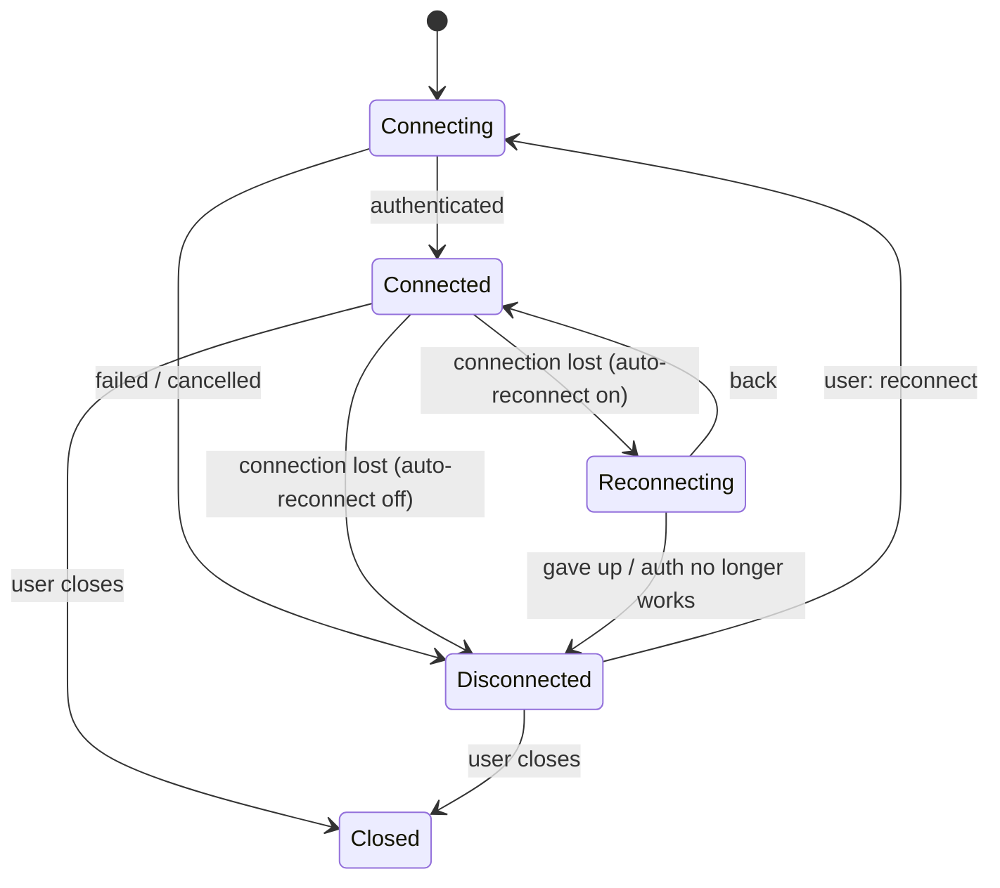

# Architecture

This document explains how Aether is put together and why. It is meant for people who want to
change the code; the [README](../README.md) covers using and building it.

## Principles

1. **The SSH engine knows nothing about the UI.** It is a library (`aether-ssh`) with a small
   callback surface. You could put a different front end on it — the tests do, with a scripted
   "user".
2. **The UI knows nothing about SSH.** It renders state and sends intentions. Every protocol
   decision, every secret and every byte of terminal data is handled in Rust.
3. **One error type crosses the boundary.** Whatever fails, the UI receives an `ErrorInfo`
   (code, title, plain-language message, hint, technical detail, "retryable?") and shows it the
   same way everywhere.
4. **Make the failure path as good as the happy path.** Reconnects, refused tunnels, changed host
   keys, wrong passwords and full disks all have explicit states and words.

## The big picture

| Layer | Crate / folder | Knows about | Must not know about |
|---|---|---|---|
| Models, persistence, parsers | `crates/aether-core` | serde, files, `~/.ssh/config`, `known_hosts` | networking, Tauri, the UI |
| Secret storage | `crates/aether-vault` | Windows Credential Manager, DPAPI | everything else |
| SSH engine | `crates/aether-ssh` | `russh`, `russh-sftp`, `aether-core` types | Tauri, windows, prompts as dialogs |
| Application shell | `src-tauri` | Tauri, the three crates above | SSH wire protocol |
| User interface | `ui/` | the IPC surface (`$lib/api`) and generated types | anything Rust-side beyond that |

## The crates

### `aether-core`

Plain data and the code that keeps it on disk.

- `model/` — `Host`, `Group`, `Settings`, `Theme`, `ForwardRule`, … All `serde` + `ts-rs`: the
  TypeScript types in `ui/src/lib/bindings` are *generated* from these structs, so the two sides
  cannot drift. (`cargo test` regenerates them; `scripts/gen-bindings-index.mjs` rebuilds the index.)
- `store/` — JSON stores (`HostStore`, `SettingsStore`, `KeyStore`, `RecentsStore`, `ThemeStore`) on top
  of `JsonFile`. Every write is atomic (temp file, flush, rename) and keeps the last *good* version as
  `.bak` — an empty or damaged file never replaces it. Every load validates and *sanitises*: a
  hand-edited or partly corrupt file degrades to defaults for the broken field instead of failing to
  start, and the problem is reported to the user as a warning. Loading tells three situations apart: bad
  *content* (moved aside as `.corrupt-…`, backup restored), an *empty* file (backup restored), and a
  file that can't be *read* at all (left exactly where it is, and never saved over — see
  [SECURITY.md](SECURITY.md)). The stores change a copy and commit it only after it reached the disk, so
  memory never runs ahead of the file.
- `ssh_config/` — an OpenSSH client-config parser (`Host` / `Match` blocks, `!` negation, globbed
  `Include`s with loop detection and file / byte budgets, `%h %p …` token expansion, OpenSSH's
  first-value-wins rule) and the conversion to Aether hosts. Importing resolves `ProxyJump` aliases
  into real links (to hosts already saved, or to ones imported alongside), and a jump alias that is only
  *used* — a quick connect, an ad-hoc hop — is read from the config when the connection is made.
- `known_hosts.rs` — OpenSSH-compatible: plain and hashed (`|1|salt|hash`) names, wildcards,
  `@revoked` (a revoked key is refused); certificate-authority entries are recognised but never
  trusted as ordinary host keys. A lookup answers *trusted*, *unknown*, *changed* (same type, other key),
  *other key type* (keys on record, none of this type — treated like a change) or *revoked*. Files are
  read however a shell or editor saved them (UTF-8, UTF-16, a stray legacy byte), and only real host
  names are ever written. Aether writes only its own file; the user's `~/.ssh/known_hosts` is
  read-only input.
- `paths.rs` — installed / portable / `AETHER_HOME` layouts.
- `error.rs` — `ErrorInfo`, `ErrorCode`, and the `UserFacing` trait every error type implements.

### `aether-vault`

A `SecretStore` trait (`put` / `get` / `delete`, synchronous) with three backends:

- **Credential Manager** for small secrets (passwords, passphrases);
- **DPAPI files** (`CryptProtectData`, user scope, application entropy) for bulky ones (private keys,
  which exceed the Credential Manager's blob limit);
- an in-memory store for non-Windows development and tests.

`open_default` composes them: installed → Credential Manager + DPAPI; portable / custom → DPAPI
files only, so a portable install leaves nothing in the machine's credential store. DPAPI files are
written under a unique temporary name, flushed and renamed into place. `Secret` wraps its bytes in
`Zeroizing`, redacts itself in `Debug`, and has a test proving it never leaks into logs; the buffers
the OS hands back are scrubbed before they are released.

### `aether-ssh`

The engine. The modules, in the order a connection uses them:

| Module | Responsibility |
|---|---|
| `spec.rs` | `ConnectSpec` (one hop), `AuthSpec`, `TransportOptions`, `ShellParams` — plain inputs. |
| `delegate.rs` | `ConnectionDelegate`: the engine's only way to ask the outside world anything (prompts, saved secrets, host-key decisions). |
| `transport.rs` | TCP (with `TCP_NODELAY`, timeouts, DNS error classification) and `ProxyCommand` child-process streams (what the host's side substitutes into the command line — `%h`, `%r`, `%n` — is validated as a plain name; `%p %u %d` are filled in too; the command starts in the user's folder with the current-directory program search off). |
| `connection.rs` | `SshConnection::connect`: walks the jump chain hop by hop (`direct-tcpip` through the previous hop), handshake, host-key check, authentication. |
| `handler.rs` | The `russh` client handler: host-key verification against `known_hosts` (and the "someone is being asked" count that pauses the handshake clock), server-initiated channels (remote forwards, agent, X11), disconnect classification. |
| `auth.rs` | The method loop: agent → public key → keyboard-interactive → password (order from the host), with 3 attempts for passwords / passphrases and "partial success" handling. A password is remembered only after the server accepts it; a rejected saved one is forgotten. |
| `keys.rs` | Key loading (OpenSSH, PEM, PKCS#8, PuTTY `.ppk`), inspection, generation (Ed25519, ECDSA, RSA), passphrase flow. |
| `agent.rs` | Windows OpenSSH agent (named pipe) and Pageant. |
| `shell.rs` | PTY channel: `pty-req`, env, startup command, agent / X11 requests, resize, EOF handling. |
| `session.rs` | `SessionManager` / `Session`: the supervisor loop, reconnect state machine, terminal fan-out, replay ring, flow control, per-session memory of "connect once" host keys and typed secrets. |
| `forward.rs`, `socks.rs` | Local / remote / dynamic forwards, SOCKS5 server, per-rule statistics and error explanations. |
| `sftp.rs`, `transfers.rs` | SFTP operations (bounded listings — in time and in number of items —, `replace_file`, which swaps a temporary file in with the old one's owner and permissions and writes in place where that isn't possible, and a client that notices its channel died); the `TransferManager` job queue (plan → resolve conflicts → run, with pause / resume / cancel; a resumed job is handed the connection's current SFTP channel). |
| `text.rs` | The editor's view of a text file: refuses what a text box can't carry (binary, non-UTF-8, UTF-16), remembers the line ending and BOM, and puts them back. |
| `x11.rs` | X11 forwarding: the fake cookie is checked on every remote program *before* anything connects to the local display (only a few may wait to show it), then swapped for the real one, and the bytes are relayed. |
| `error.rs` | `SshError` and its translation into `ErrorInfo` in plain language. |
| `testing.rs` | An in-process SSH server (built on `russh`) with switches for every behaviour the tests need. |

## The IPC boundary

`src-tauri/src/commands/*` exposes about 90 `#[tauri::command]` functions, grouped by area (`hosts`,
`keys`, `sessions`, `sftp`, `settings`, `local`, `app`). Rules:

- Commands take and return the generated model types; failures return `ErrorInfo`.
- The UI never calls Tauri directly. It goes through `ui/src/lib/api` — a typed interface with two
  implementations: the real one (`tauri.ts`) and an in-memory fake (`fake.ts`) used by the browser
  preview and unit tests. Adding a capability means adding it to `types.ts` and both.
- **Events** (Rust → UI): `session:state`, `session:latency`, `session:forwards`, `session:banner`,
  `prompt:request`, `prompt:closed`, `transfer:update`, `settings:changed`, `hosts:changed`,
  `tray:connect`, `app:args`.
- **Terminal data** does not go through events. Each attached terminal gets a Tauri `Channel` —
  a raw, ordered byte stream — so output is never JSON-encoded or reordered.
- **Slow work never runs on the UI thread.** File-system calls, key stretching and config reads go
  through `commands::blocking` (`spawn_blocking`); a command that blocked the thread it was called on
  would freeze every window.
- **Windows** are created from `async` commands only. Building a webview window on the main thread
  (which is where *synchronous* commands and tray / menu handlers run) deadlocks on Windows, so
  `window::create` always builds on a worker thread.

### Threading note

Synchronous Tauri commands run on the UI thread, which has no Tokio runtime. Anything such a command
might touch that spawns tasks (a new terminal on a session, resuming a paused transfer) therefore
captures a `tokio::runtime::Handle` when the object is created and spawns through it. There are
regression tests that call these from a plain `std::thread`.

## A session's life

- `SessionManager::open` creates a `Session` and starts its **supervisor task**. The supervisor owns
  the connection: it connects, waits for the connection to end, and decides what happens next.
- **A first connection that fails is not retried automatically.** Wrong password, changed host key,
  unreachable host — retrying would only hide the problem. The user gets an error card with
  *Edit host* / *Try again*. Automatic reconnects apply only to a session that *worked*.
- **Reconnect** waits `1 s, 2 s, 4 s, 8 s, 15 s, 30 s, 30 s …` (plus up to 20 % jitter), up to the
  configured number of attempts (0 = keep trying). Passwords and passphrases typed during the first
  connection are kept in memory (zeroized, per hop) so a reconnect doesn't ask again; they are
  dropped with the session. A host key that has *changed* during a reconnect is never accepted
  silently — it raises the same blocking prompt as a fresh connection. A key accepted with *Connect
  once* is pinned for the session (so the same server isn't asked about again), and a *different* key
  where that one was is a change: the prompt appears and the typed secrets for that hop are forgotten.
  Failures that only a person can fix end the retries — also when it was a *jump host* that refused.
- After a reconnect the supervisor **re-opens every shell** (new PTY, same terminal id — the UI
  attaches to the same `Channel`), **re-establishes the forwards** that were running, and re-opens
  SFTP lazily. A shell that can't be opened because the connection itself went away waits for the next
  reconnect instead of ending the terminal; a terminal closed while its shell was still opening takes
  that shell down with it.
- **Keepalives** (`keepalive@openssh.com`, interval and miss count configurable) turn "the network
  silently died" into a prompt, classified disconnect instead of an eternal freeze.

### Terminals, replay and flow control

- Every terminal keeps the last **2 MiB** of output in a ring buffer. A window that attaches (a new
  window after tear-off, or the same one after a reload of the view) first receives the replay, then
  live data — in order, without gaps. `terminal_attach` reports how many bytes the replay was, and the
  controller treats exactly that many as *history*: drawn, but not acted on (no bell, notification,
  clipboard write, and no answers to the queries it contains).
- **Back-pressure.** The UI acknowledges bytes after xterm has parsed them. The engine stops reading
  from the SSH channel while more than **1 MiB** is unacknowledged, so a fast remote producer
  (`cat /dev/urandom | xxd`) makes the *remote* wait instead of ballooning memory or freezing the
  renderer. The SSH window itself provides the network-level back-pressure.
- Resize events are debounced in the UI and sent as `window-change` requests.

### Prompts

The engine asks questions through `ConnectionDelegate::prompt` / `verify_host_key`. In the app these
land in the `PromptBroker`, which turns each into a `prompt:request` event for the window that owns
the connection, then waits for `respond_prompt`. Answers can't outlive their connection: closing a
window or session cancels everything pending for it (`prompt:closed`) — and so does the connection
attempt giving up, through a drop guard, so a cancelled attempt never leaves its dialog on screen.
Host-key prompts distinguish *unknown* from *changed* (which also covers an unfamiliar key type); a
changed key can only be accepted with an explicit, separate "replace" decision. A ProxyCommand being
saved or imported is confirmed in a *native* dialog raised from Rust, which the page can't click.

## The terminal in the UI

`ui/src/lib/terminal/controller.ts` wraps xterm.js and is deliberately framework-free:

- **Renderer:** WebGL with automatic fallback to the DOM renderer (and a setting to force either).
- **Ligatures:** a custom character joiner (`ligatures.ts`) for the common programming-font sequences,
  so they work with the WebGL renderer too.
- **Unicode:** grapheme clusters / emoji via the unicode-graphemes addon.
- **Addons:** fit, search, web-links, clipboard (OSC 52, opt-in), image (Sixel / iTerm2, opt-in).
- **Shell integration:** OSC 7 (working directory), OSC 133 (command finished → notification if it
  ran long and the window isn't focused), OSC 9 / 777 (notifications). Everything a server can make the
  terminal do goes through `safety.ts`: titles and notifications become plain bounded text, are
  rate-limited and wear the session's name; clipboard writes are capped and announced; paste loses its
  control codes; dropped file names are shell-quoted. Handlers never throw into the parser.
- A pane's `TerminalView` owns one controller; panes are laid out from a flat keyed list
  (`layoutPanes`) so splitting or closing a neighbour never re-mounts — and therefore never
  re-attaches or flickers — the others.

## State on the UI side

Svelte 5 runes, one store per concern (`ui/src/lib/stores`):

| Store | Holds |
|---|---|
| `workspace` | tabs, pane trees, per-pane status; opens, splits, tears off, restores |
| `sessions` | live connection state, latency, forwards (fed by events) |
| `hosts`, `settings` | mirrors of the Rust stores (changes arrive as events) |
| `prompts` | the queue of questions the engine asked |
| `transfers` | SFTP job progress |
| `ui` | dialogs, menus, toasts, palette, sidebar |

Commands (`commands.svelte.ts`) are the single registry behind the palette, the menus, and the
keymap, so a feature added once shows up in all three and can be rebound.

### Focus and dialogs

Dialogs use one `Modal` with a focus trap that prefers an explicit `data-autofocus` field. Svelte
*resumes* a block that is brought back while it is still fading out, so a dialog can be revived with
its contents made `inert` and focus lost; the trap re-takes focus when that happens, and each prompt
is rendered under a `{#key}` so a retry is a fresh dialog.

### Drag and drop

HTML5 drag and drop does not work in a Tauri window that also has OS file-drop enabled (needed for
dropping Explorer files onto SFTP and terminals). Reordering tabs, moving hosts into groups and the
SFTP pane-to-pane drags therefore use a small pointer-based implementation (`dom/dnd.svelte.ts`);
OS file drops are routed by `stores/filedrop.svelte.ts` to whichever target is under the pointer.

## SFTP and transfers

- The browser (`ui/src/lib/sftp`) is written against a `FileProvider` interface; `localProvider` talks
  to the Windows file system through `commands/local.rs`, `remoteProvider` to the session's SFTP
  channel. Both panes use the same `PaneState` (selection, type-ahead, sorting, inline rename).
- A transfer starts as a **plan** (walk the tree, find name clashes), which may open the conflict
  dialog; confirmed plans become **jobs** on the `TransferManager` with a bounded number running at
  once. Downloads are written to `<name>.aetherpart` and renamed on success, so a cancelled or failed
  download never leaves a half-written file under the real name (the partial file is removed on cancel
  and continued after a pause, if this job wrote it); an upload that was paused continues from the size
  already on the server. Every name the server supplies is reduced to one safe path component first.
- The **text editor** reads a file through `text.rs` and saves with `replace_file`: write beside the
  original (created with the original's permissions, then given its owner), move the original aside,
  move the new one in, delete the old one — so the file is never half-written and the original comes back
  if the swap fails; when a rename's answer is lost the client looks at what is where (`settle`) before
  saying anything, and when it can't ask, the error names the files. Where a swap isn't possible (another
  owner, a closed folder, no `setstat`, a file that can't be moved) it falls back to writing in place.
  A version (size + modified time) taken when the file was opened turns a save over somebody else's edit
  into a `conflict` the person can override.
- Name clashes are checked on both sides before a rename, so "file exists" is explained instead of
  surfacing as an opaque SFTP status.

## Persistence and migration

All user data is JSON with a `version` field. `store` loads defensively (unknown fields ignored,
invalid values replaced with defaults and reported), writes atomically, keeps one backup of the last
good version, and refuses to overwrite a file it could not read. The
workspace snapshot (open tabs) is written only when "restore tabs on start" is on, debounced, and
contains host ids and layout — never session data or secrets.

## Security boundaries (summary)

Full details are in [SECURITY.md](SECURITY.md). Architecturally: the renderer is treated as less
trusted than the core (strict CSP, no remote content, a small Tauri capability set, no generic file
or shell plugins); secrets cross the boundary once — typed into a prompt, sent to Rust — and are
never sent back; nothing secret is ever handed to `tracing`, and a test guards the `Secret` type's
`Debug` output.

## Testing

| Layer | How |
|---|---|
| Parsers, stores, models | unit tests with temp directories (`aether-core`) |
| Vault | real Credential Manager round-trip, DPAPI tamper tests, "never writes plaintext" |
| Engine | `aether_ssh::testing::TestServer` — an in-process SSH server that can: demand specific auth, offer 2FA (also multi-step, PAM-style), drop connections on cue, forbid forwarding, present a new host key, request X11, serve SFTP (refusing creates or renames on cue, and — like a real server — refusing to rename over a file). Tests cover auth fallbacks, jump chains, forwards, reconnect with forward restoration, "connect once" pinning, keepalive death, back-pressure, SFTP pause / resume / cancel / atomic save, host-key policies, ProxyCommand. |
| IPC glue | resolver and DTO tests in `src-tauri` |
| UI | Vitest for the pure pieces (pane layout, paths, fuzzy search, shortcuts, formatting); `svelte-check` for types and accessibility |
| End to end | a real OpenSSH container; see the README |

## Decisions worth knowing about

- **Tauri over egui.** A terminal needs excellent text rendering, ligatures, IME and accessibility
  hooks; xterm.js on WebView2 provides them today, and the HTML/CSS layer makes the polished
  interface — animation, theming, a real command palette — far cheaper.
- **`russh` with the `ring` backend**, not `aws-lc-rs`: the latter needs NASM on Windows, which would
  be a build prerequisite for every contributor, and `ring` covers everything Aether negotiates.
- **JSON, not SQLite.** The data is small and human-meaningful; plain files are diffable, backed up by
  copying, and recoverable by hand.
- **`panic = "unwind"` in release.** Tokio isolates a panicking task, so one bad session cannot take
  every other live connection down with it; a panic hook writes the backtrace to the log.
- **No SSH logic in JavaScript, ever.** It keeps secrets out of the renderer and makes the engine
  testable without a browser.
